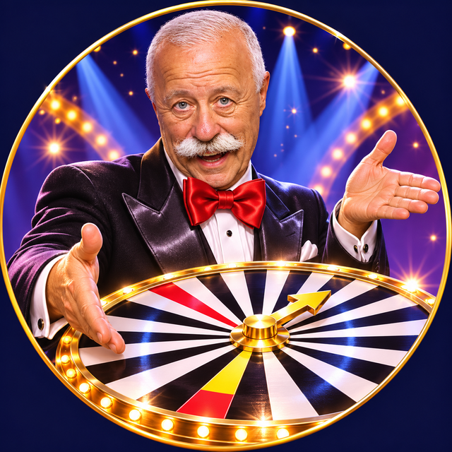

<p align="center"></p>

<h1 align="center">Pole Chudes Bot</h1>

<p align="center">
  A joke Telegram bot for friends' group chats: once a day it spins a prize wheel and picks one member for a mock title.<br>
  The host is a parody of a Russian TV game-show presenter.
</p>

<p align="center">
  <a href="https://github.com/belaytzev/pole-chudes-bot/actions/workflows/ci.yml"></a>
  <a href="https://github.com/belaytzev/pole-chudes-bot/actions/workflows/codeql.yml"></a>
  <a href="https://github.com/belaytzev/pole-chudes-bot/releases"></a>
  <a href="go.mod"></a>
  <a href="LICENSE"></a>
</p>

<p align="center">English · <a href="README.ru.md">Русский</a></p>

> The bot speaks Russian: its jokes, phrases and commands are written for a Russian-speaking chat. This README is in English so that anyone can run it, translate it or add phrases.

## What it does

Someone in the chat sends `/baraban`, and the bot answers with one message that changes in front of everyone:

> Good evening! This is the capital show "Pole Chudes"! Players at the drum: 5.
> Spin the drum! 🎡
> Sector "Shame" on the drum! First time I've seen that.
> Someone is passing me pickles from Saratov… Thanks, Mom! 🥒
> 🟦🟦🟦🟦🟦 of the day
> П🟦🟦🟦Р of the day. There is such a letter! 🎁 Bring in the prize! Today's title goes to Vasya!

The winner is random and the same for the whole day. A second `/baraban` reminds the chat who has already won. The bot keeps score, so at the end of the year everyone can see who got the title most often.

The title itself is masked (`П***р дня`) on purpose, to keep the bot clear of Telegram's content filters. It is one constant, `Title`, in `phrases.go`.

### Features

- **Daily draw.** One winner per chat per day. The day changes at midnight in the configured time zone.
- **Opt-in players.** Telegram does not tell bots who is in a chat, so everyone joins with `/igrok`. A member who leaves the chat is removed automatically.
- **Leaderboards.** A yearly one and an all-time one, plus a personal score.
- **Milestones.** Special lines for the 1st, 10th, 50th and 100th win.
- **Birthdays.** The bot reads the date from the Telegram profile or takes it by hand. The birthday person sits out that day's draw and gets a greeting at 10:00.
- **Anniversary.** A greeting on the anniversary of the chat's first draw.
- **Quote book.** Reply `/citata` to a message to save it, send `/citata` alone to get a random saved quote.
- **Spin sticker.** An optional animated sticker plays before the draw and disappears afterwards.
- **Small and safe.** One static Go binary, SQLite storage, a 14 MB distroless image that runs as non-root with a read-only root filesystem. It uses about 20 MB of memory.

## Commands

| Command | What it does |
|---|---|
| `/igrok` | join the game |
| `/vyhod` | leave the game, past wins are kept |
| `/baraban` | spin the drum, once a day per chat |
| `/kapital` | leaderboard for this year |
| `/zalslavy` | all-time leaderboard |
| `/moi` | your own score |
| `/dr [dd.mm]` | set your birthday, e.g. `/dr 15.03`; without an argument the bot tries your Telegram profile |
| `/citata` | reply to a message to save it as a quote; alone, shows a random quote |
| `/start`, `/help` | the command list |

All game commands work only in group chats. At least two players are needed for a draw.

## Quick start

You need a machine with Docker that runs around the clock.

1. Create a bot with [@BotFather](https://t.me/BotFather): send `/newbot` and copy the token. Leave privacy mode on, the bot only reads commands.
2. Run it:

   ```sh
   docker run -d --name pole-chudes-bot --restart unless-stopped \
     -e BOT_TOKEN=your_token \
     -v pole-chudes-data:/data \
     ghcr.io/belaytzev/pole-chudes-bot:latest
   ```

   Or with Docker Compose: copy [`.env.example`](.env.example) to `.env`, fill in `BOT_TOKEN`, then `docker compose up -d`.
3. Add the bot to a group chat and ask everyone to send `/igrok`.

Run **only one copy per token**. Two pollers on one token get `409 Conflict` and Telegram hands the updates to just one of them.

Images are published to `ghcr.io/belaytzev/pole-chudes-bot` as `latest` (the `main` branch), `X.Y.Z` (a release tag) and `sha-<commit>`. Pin a version in production.

### Configuration

| Variable | Default | Description |
|---|---|---|
| `BOT_TOKEN` | — (required) | bot token from @BotFather |
| `TZ` | `Europe/Moscow` | time zone: day boundary and the 10:00 greeting time |
| `DB_PATH` | `bot.db` (`/data/bot.db` in the image) | SQLite file |
| `SPIN_STICKER` | — | `file_id` of a sticker sent before each draw and deleted after it |

### Data and backups

All state is one SQLite file in WAL mode: players, wins, birthdays, quotes and sent greetings. There is no other copy, so back the file up (stop the bot or use `sqlite3 bot.db ".backup copy.db"`). Upgrades only add tables, existing data is never rewritten.

Size is not a concern: a draw takes about 58 bytes, so 100 chats playing daily for 10 years come to roughly 21 MB.

### Kubernetes

Run a single replica with the `Recreate` strategy and a persistent volume mounted at `/data`. A volume of 100 Mi is plenty. The image runs as uid `65532` and expects a writable `/data` and an otherwise read-only filesystem.

## Birthdays from the profile

Telegram gives a bot a user's birthday only if that user has opened the date to everyone in the privacy settings. When the date is hidden or missing, `/dr 15.03` sets it by hand. A date typed by hand is never overwritten by the profile one. The bot greets people on 28 February when their birthday is 29 February in a non-leap year.

## Visual identity

[`assets/`](assets) holds:

- `icon.png` — the bot's profile picture, 640×640: the game-show host with the prize drum;
- `stickers/` — five static stickers of the host (`welcome`, `spin`, `pickle`, `gift`, `winner`), 512 px on the long side with transparent rounded corners;
- `drum_spin.webm` — a transparent video sticker of the spinning drum (512×327, 1.6 s), rendered by [`draw_drum.py`](assets/draw_drum.py).

The host pictures are **AI-generated** parody illustrations of a TV game-show host in the manner of a 1990s Russian show. They are unofficial fan art, see the disclaimer under [License](#license). The drum animation is drawn in code:

```sh
uv run --with pillow python assets/draw_drum.py /tmp/frames
ffmpeg -framerate 30 -i /tmp/frames/%03d.png -c:v libvpx-vp9 -pix_fmt yuva420p -b:v 0 -crf 36 -auto-alt-ref 0 drum_spin.webm
```

Set the picture with BotFather's `/setuserpic`. To use the spinning sticker, upload `drum_spin.webm` to a video sticker set with [@Stickers](https://t.me/Stickers), fetch the sticker's `file_id` from the Bot API (`getStickerSet`) and pass it as `SPIN_STICKER`. Telegram's limits for a video sticker are 512 px on one side, up to 3 seconds and 256 KB.

## Development

Go 1.27+ and [golangci-lint](https://golangci-lint.run/) v2 are required.

```sh
BOT_TOKEN=... DB_PATH=/tmp/pole-test.db go run .   # run with a test bot
make check                                         # vet, tests with -race, lint, gofmt
```

| File | Role |
|---|---|
| `main.go` | bot setup, commands, the draw animation |
| `store.go`, `store_fun.go` | SQLite storage: players, draws, birthdays, quotes, greetings |
| `fun.go` | birthdays, greetings, quote book |
| `phrases.go`, `fun_phrases.go` | the host's lines, one list per stage of the draw |

CI runs `gofmt`, `go vet`, tests with the race detector, golangci-lint, `govulncheck` and CodeQL, then builds the Docker image. A pushed `v*` tag publishes the image and creates a GitHub release.

See [CONTRIBUTING.md](CONTRIBUTING.md). AI coding agents should read [AGENTS.md](AGENTS.md).

## Security

Found a vulnerability? Please report it privately, see [SECURITY.md](SECURITY.md).

## License

[MIT](LICENSE). This is an unofficial fan parody and is not affiliated with, or endorsed by, any TV show, broadcaster or person it imitates.
