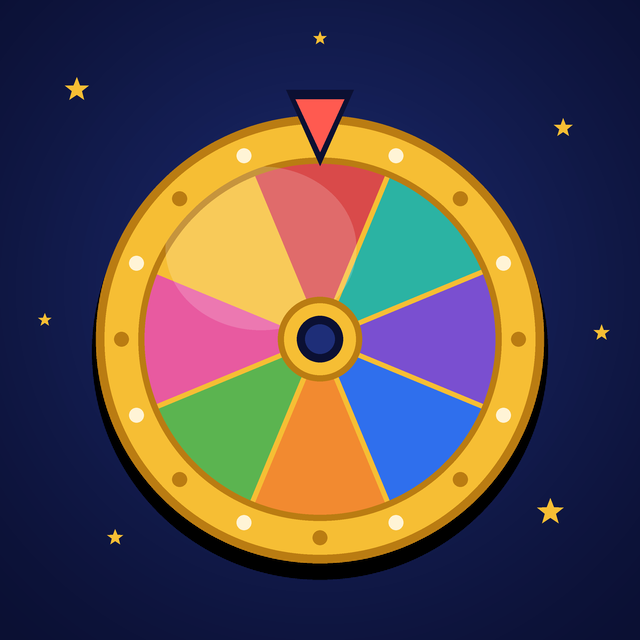

<p align="center"></p>

# Поле Чудес. Игрок дня

[English](README.md) · Русский

Шуточный Telegram-бот для дружеских чатов. Раз в день он крутит барабан и выбирает одного из участников «П\*\*\*р дня». Розыгрыш ведёт пародия на Леонида Якубовича из «Поля Чудес»: «Вращайте барабан!», сектор «Приз», солёные огурцы из Саратова и табло, на котором открываются буквы.

Идея пришла из популярных чатных игр в Telegram, где бот каждый день выбирает «пидора дня». Здесь от них осталась только эта игра, а ведущий говорит как в капитал-шоу.

## Как это выглядит

Кто-то в чате пишет `/baraban`, и бот отвечает одним сообщением, которое меняется у всех на глазах:

> Добрый вечер! В эфире капитал-шоу «Поле Чудес»! Игроков у барабана: 5.
>
> Вращайте барабан! 🎡
>
> Сектор «Позор» на барабане! Первый раз такое вижу.
>
> Тут мне передают солёные огурцы из Саратова… Спасибо, мама! 🥒
>
> 🟦🟦🟦🟦🟦 дня
>
> П🟦🟦🟦Р дня. Есть такая буква! 🎁 Приз в студию! Сегодня П\*\*\*р дня — Вася!

Победитель выбирается случайно и один на весь день. Если позвать барабан ещё раз, ведущий напомнит, кто уже победил, и пригласит приходить завтра. Бот ведёт счёт побед, так что в конце года видно, кто чаще всех получал звание.

## Как играть

1. Добавьте бота в групповой чат.
2. Каждый, кто хочет играть, пишет `/igrok`. Без этого бот вас не знает: Telegram не показывает ботам список участников чата.
3. Когда игроков хотя бы двое, любой может написать `/baraban`.

| Команда | Что делает |
|---|---|
| `/igrok` | записаться в игру |
| `/vyhod` | выйти из игры, прошлые победы сохраняются |
| `/baraban` | крутить барабан, один раз в день |
| `/kapital` | рейтинг за этот год |
| `/zalslavy` | рейтинг за всё время |
| `/moi` | ваш личный счёт |
| `/dr 15.03` | записать день рождения; без даты бот попробует взять её из профиля Telegram |
| `/citata` | ответом на сообщение сохраняет цитату, без ответа показывает случайную |

Именинник в свой день в розыгрыше не участвует, а в 10:00 бот его поздравляет. Годовщину первого розыгрыша в чате бот тоже отмечает. Дату из профиля Telegram отдаёт боту, только если она открыта всем, иначе её нужно ввести вручную.

Когда участник выходит из чата, бот обычно сам убирает его из игры. В очень больших группах Telegram об этом не сообщает, там надёжнее `/vyhod`.

## Как запустить своего бота

Понадобится компьютер или сервер с Docker, который работает круглосуточно.

1. Напишите [@BotFather](https://t.me/BotFather) в Telegram, создайте бота командой `/newbot` и скопируйте токен.
2. Запустите:

   ```sh
   docker run -d --name pole-chudes-bot --restart unless-stopped \
     -e BOT_TOKEN=ваш_токен \
     -v pole-chudes-data:/data \
     ghcr.io/belaytzev/pole-chudes-bot:latest
   ```

3. Добавьте бота в чат.

Результаты игр хранятся в томе `pole-chudes-data` и переживают перезапуск. Новый день начинается в полночь по Москве. Другой часовой пояс задаётся параметром `-e TZ=Europe/Berlin`.

Запускайте только одну копию бота на токен, иначе Telegram отдаст сообщения только одной из них.

## Для разработчиков

Бот написан на Go, данные лежат в SQLite. Фразы ведущего собраны в `phrases.go`, по списку на каждый этап розыгрыша. Звание задаёт константа `Title`.

```sh
BOT_TOKEN=... go run .
go test ./...
```

Необязательная переменная `SPIN_STICKER` — `file_id` стикера, который бот присылает перед розыгрышем. Готовые картинки и анимация барабана лежат в `assets/`, `draw.py` перерисовывает их.

Каждый коммит в `main` публикует образ с тегом `latest`, а тег `vX.Y.Z` даёт образ `X.Y.Z`.
